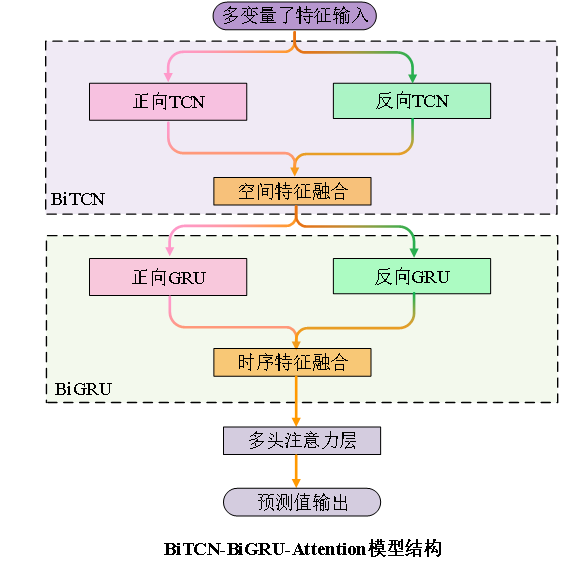
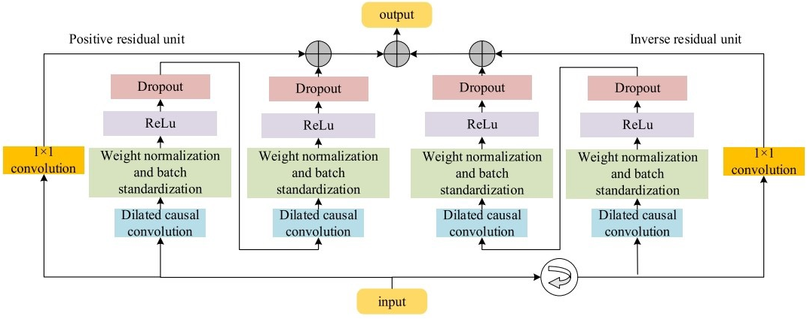
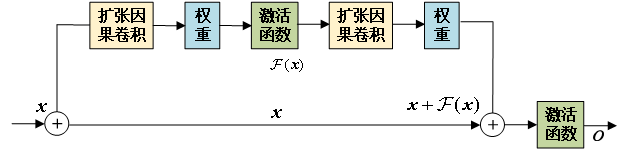
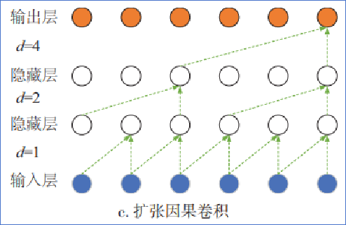
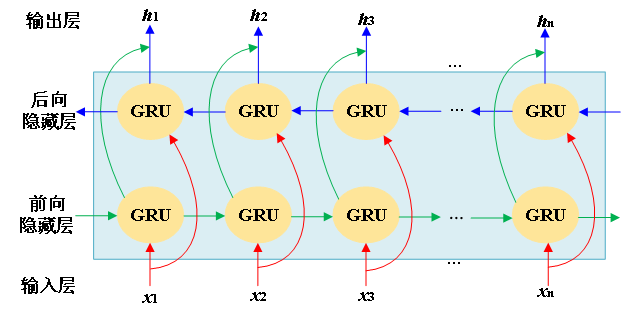
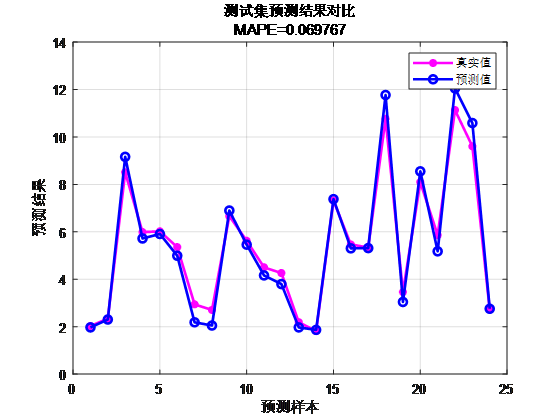
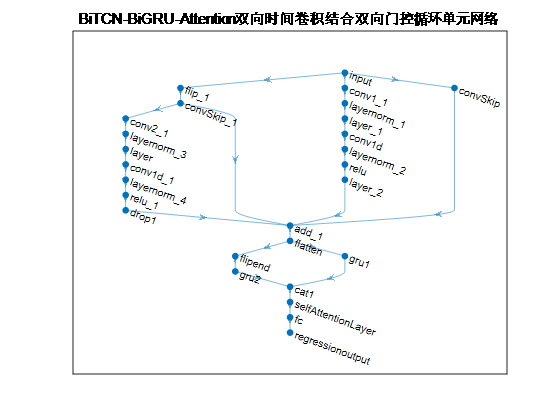
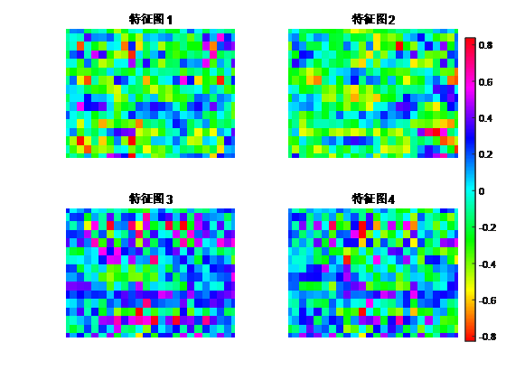
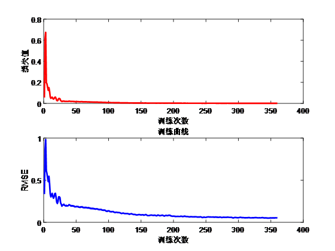
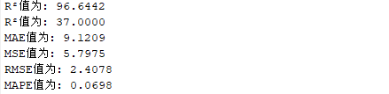

# Multi-Innovation: BiTCN-BiGRU-Attention Prediction Program Code! MATLAB program, highly innovative! Excel import, directly run.

Program Platform: Requirements for Matlab 2023 or above.
The proposal introduces a forward-looking 24-step multivariate time series regression prediction algorithm based on the Bidirectional Time Convolutional Network (BiTCN) combined with the BiGRU-Attention mechanism, which is highly innovative.

Functionality: Multivariate feature input and univariate sequence output, using meteorological features from the current day to predict wind speed in advance by 24 steps. Results such as MAPE, RMSE, MAE are provided for display.

Innovations include six major aspects:
① Bidirectional Time Convolution: The BiTCN introduces bidirectional time convolution, combining past and future information of time series data, enabling the model to better capture temporal patterns within the time series. Traditional unidirectional convolution focuses only on local contextual information, whereas bidirectional convolution can capture important features from multiple directions.

② Residual Connection: The residual connection used in the model helps alleviate gradient vanishing issues, allowing the network to learn feature representations more deeply. The introduction of residual connections makes the model easier to train and accelerates the convergence process.

③ Multiscale Convolution: The BiTCN can capture different levels of time features through stacking multiple expansion causal convolution layers of different scales. This multiscale convolution strategy helps the model understand different frequencies and temporal patterns within the time series more comprehensively.

④ Recursive Stacking: The model can be enhanced by recursively stacking multiple BiTCN modules, allowing the model to extract and fuse features at different abstraction levels progressively, thereby better predicting time series.
Bidirectional Gated Recurrent Unit (BiGRU): A recurrent neural network capable of capturing long-range dependencies within sequences. Through its bidirectionality, BiGRU can simultaneously consider past and future information, enhancing the model's ability to perceive dynamic changes in time series.
6. Introduction of Self-Attention Mechanism: The Self-Attention mechanism allows the model to more flexibly weight input information across different time steps, which helps the model focus more on time points that have a greater impact on the prediction target.
Applicable fields:
Applications include wind speed forecasting, photovoltaic power forecasting, power generation forecasting, and carbon price forecasting.
Convenient to use:
Directly import data into the Excel table without requiring significant modifications to the program. The internal comments are detailed and easy to understand.
The program results are as follows: Dataset format:
On the day, 18 meteorological features (characteristics) were sampled over a period of 24 hours, with the output being the power output (real values) for the same day's 24 hours. This is equivalent to an input of 18×24 and an output of 1×24, totaling 75 such samples.
\n        \n      Comparison of predicted values with actual values
\n        \n      Model Structure:
\n        \n      Feature Visualization:
\n        \n      Training Curve:
\n        \n  
Evaluation indicators:
\n        \n  

## Images

<!-- PAYMENT_BLOCK -->

## Get this dataset

- Payment link (Stripe): [Buy now](https://buy.stripe.com/3cs8yP7sY87d0vu9AB)
- Payment QR code: 

<!-- /PAYMENT_BLOCK -->
